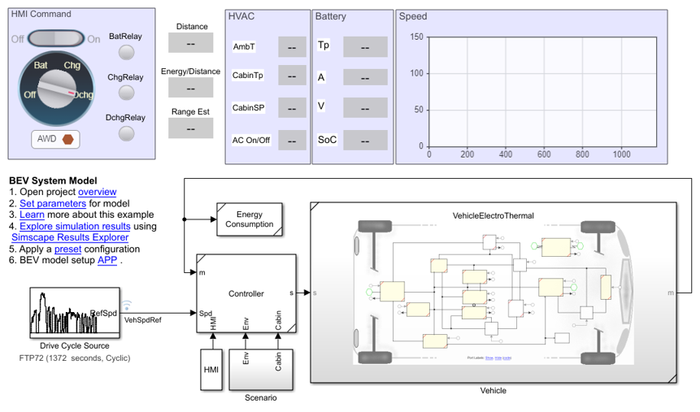
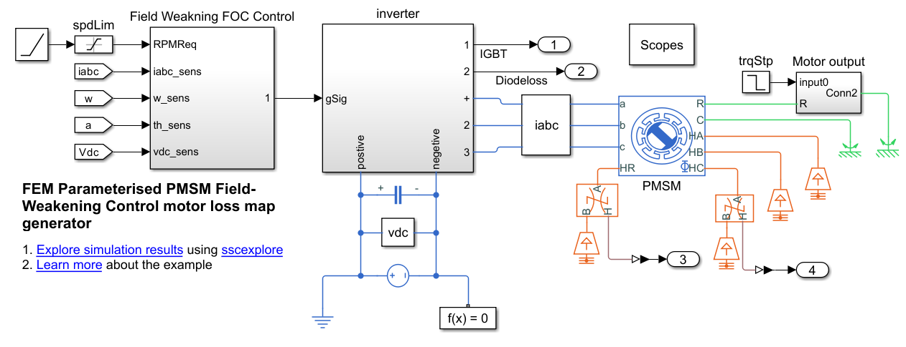
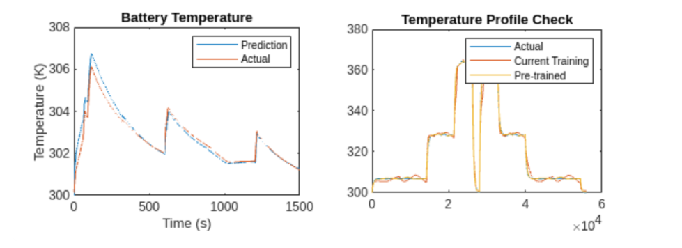
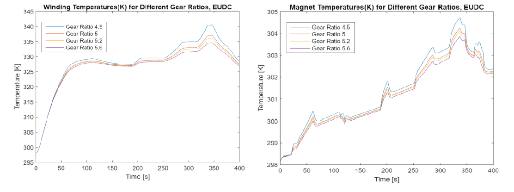
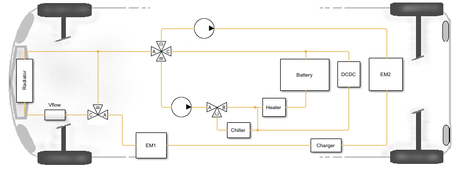
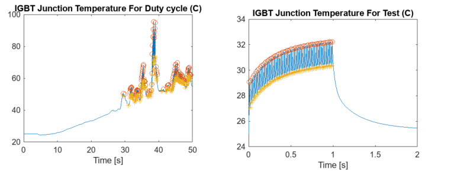

# Electric Vehicle Design with Simscape

<table>
  <tr>
    <td class="text-column" width="1200">
      In this project, you will find Simscape workflows for designing battery electric vehicles.
      Modeling and simulation help you meet range targets under different environmental conditions
      and evaluate components and complete vehicle platforms.
    </td>
  </tr>
</table>

<table>
  <tr>
    <td class="image-column" width="1200"></td>
  </tr>
</table>

## Electrical Analysis

<table>
  <tr>
    <td class="text-column" width="1200">
      On the electrical side, you size battery packs to meet range targets, build virtual
      sensors for battery temperature estimation, generate motor and inverter loss maps,
      and compare vehicle range across drive cycles and ambient conditions.
    </td>
  </tr>
</table>

<table>
  <tr>
    <td class="image-column" width="600" align="center" valign="middle"></td>
    <td class="image-column" width="600" align="center" valign="middle"></td>
  </tr>
</table>

## Mechanical Analysis

<table>
  <tr>
    <td class="text-column" width="1200">
      On the mechanical side, you select a fixed gear ratio for the electric drivetrain.
      Sweep candidate gear ratios over EUDC and US06 drive cycles, compare motor winding
      and magnet temperatures, and identify a suitable ratio based on motor thermal performance.
    </td>
  </tr>
</table>

<table>
  <tr>
    <td class="image-column" width="1200" align="center" valign="middle"></td>
  </tr>
</table>

## Thermal Analysis

<table>
  <tr>
    <td class="text-column" width="1200">
      On the thermal side, you explore vehicle thermal management and assess motor thermal
      durability over extended duty cycles at different coolant temperatures. Compare winding
      and magnet temperatures against limits, and estimate inverter power-module life from
      junction-temperature cycles.
    </td>
  </tr>
</table>

<table>
  <tr>
    <td class="image-column" width="600" align="center" valign="middle"></td>
    <td class="image-column" width="600" align="center" valign="middle"></td>
  </tr>
</table>

## To Get Started

* Clone this repository and open `ElectricVehicleSimscape.prj`.
* Launch the BEV Setup App (`BEVapp`) or select presets using `OpenPresetPicker`.

## Requirements

* MATLAB&reg; release R2024b or newer.
* Simulink&reg;, Simscape&trade;, Simscape Battery&trade;, Simscape Driveline&trade;, Simscape Fluids&trade;, and Simscape Electrical&trade;.

Copyright 2022 - 2026 The MathWorks, Inc.
