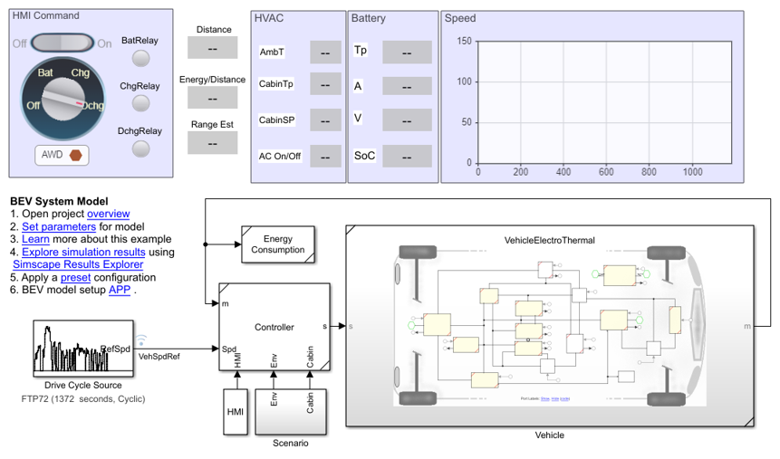
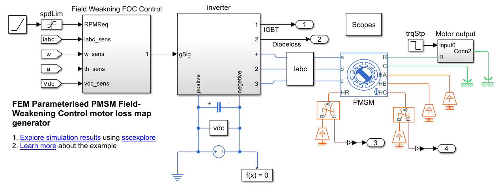
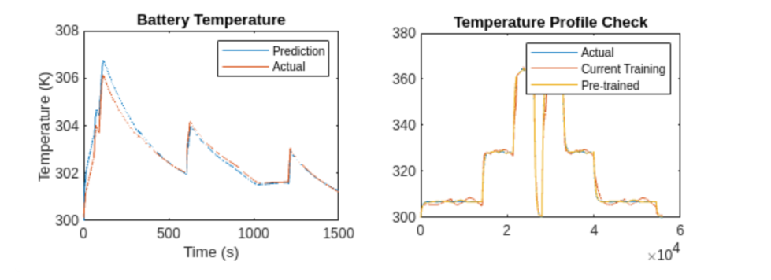
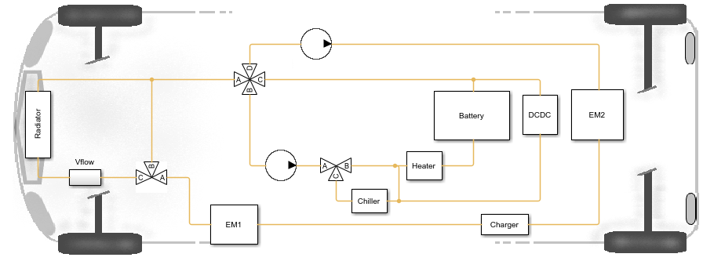
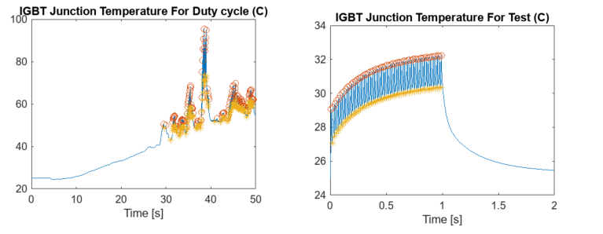
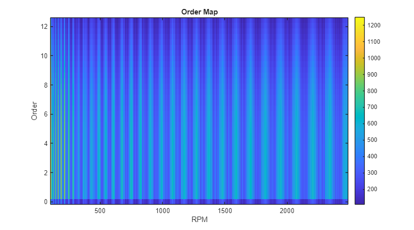
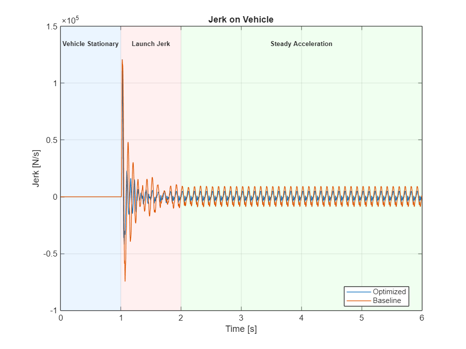

# Electric Vehicle Design with Simscape

<table>
  <tr>
    <td class="text-column" width=1200>
      In this project, you will find Simscape workflows for designing battery electric vehicles.
      Modeling and simulation help you meet range targets under different environmental conditions
      and evaluate components and complete vehicle platforms.
    </td>
  </tr>
</table>

<table>
  <tr>
    <td class="image-column" width=1200 align="center">
      

    </td>
  </tr>
</table>

## Electrical Analysis

<table>
  <tr>
    <td class="text-column" width=1200>
      On the electrical side, you size battery packs to meet range targets, build virtual
      sensors for battery temperature estimation, generate motor and inverter loss maps, and
      compare vehicle range across drive cycles, ambient temperatures, and HVAC loads.
    </td>
  </tr>
</table>

<table>
  <tr>
    <td class="image-column" width="600" align="center" valign="middle"></td>
    <td class="image-column" width="600" align="center" valign="middle"></td>
  </tr>
</table>

## Thermal Analysis

<table>
  <tr>
    <td class="text-column" width=1200>
      On the thermal side, you assess motor thermal durability over extended duty cycles at
      different coolant temperatures, compare winding and magnet temperatures against limits,
      and estimate inverter power-module life from junction-temperature cycles.
    </td>
  </tr>
</table>

<table>
  <tr>
    <td class="image-column" width="600" align="center" valign="middle"></td>
    <td class="image-column" width="600" align="center" valign="middle"></td>
  </tr>
</table>

## Mechanical Analysis

<table>
  <tr>
    <td class="text-column" width=1200>
      On the mechanical side, you select gear ratios within motor thermal limits, evaluate
      torque ripple and driveline vibration using frequency order maps, and optimize launch
      ratios to reduce vehicle jerk while maintaining acceleration.
    </td>
  </tr>
</table>

<table>
  <tr>
    <td class="image-column" width="600" align="center" valign="middle"></td>
    <td class="image-column" width="600" align="center" valign="middle"></td>
  </tr>
</table>

## To Get Started

* Clone this repository and open `ElectricVehicleSimscape.prj`.
* Select a preset using `OpenPresetPicker` to get started.
* Use the BEV Setup App (`BEVapp`) when you want a custom vehicle configuration.

## Requirement(s)

* MATLAB&reg; release R2025b or newer
* Simulink&reg;, Simscape&trade;, Simscape Battery&trade;, Simscape Driveline&trade;, Simscape Fluids&trade;, Simscape Electrical&trade;, Stateflow&reg;, Powertrain Blockset&trade;, Deep Learning Toolbox&trade;, MATLAB Coder&trade;, Predictive Maintenance Toolbox&trade;, Signal Processing Toolbox&trade;, System Identification Toolbox&trade;, Statistics and Machine Learning Toolbox&trade;, Optimization Toolbox&trade;, Global Optimization Toolbox&trade;

Copyright 2022 - 2026 The MathWorks, Inc.
